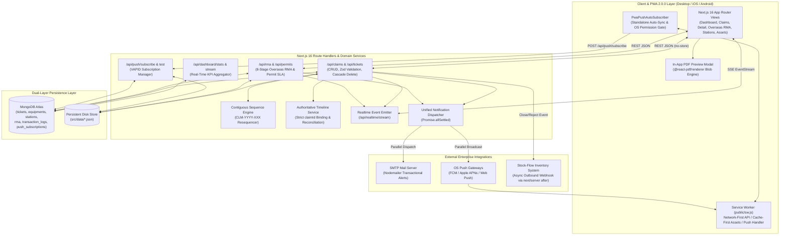
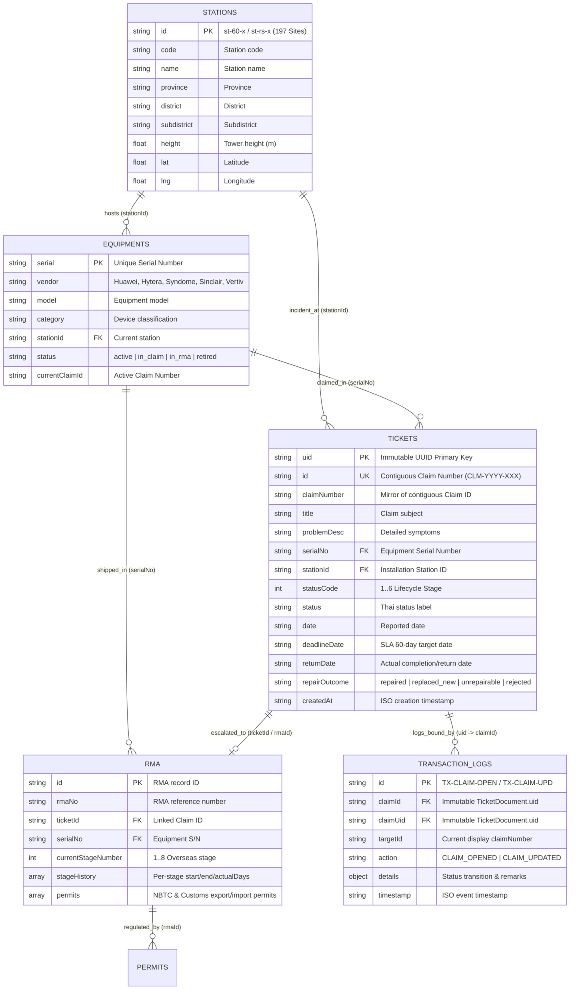
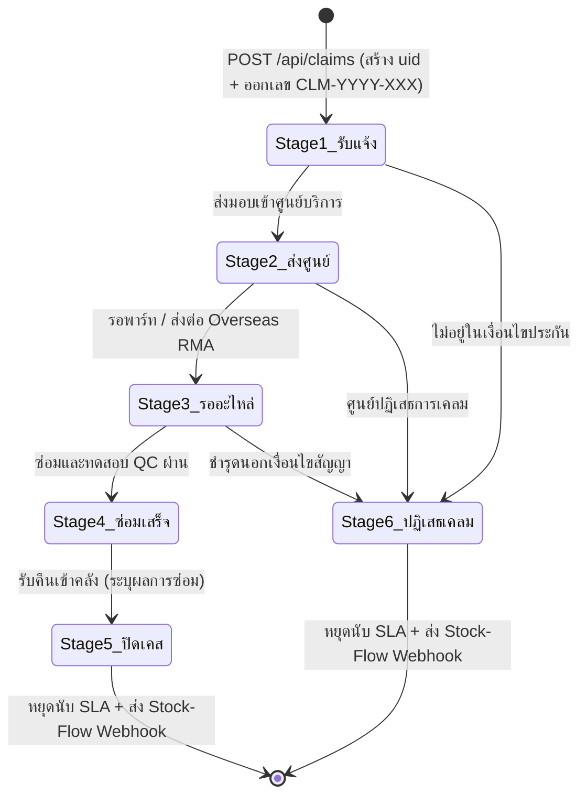
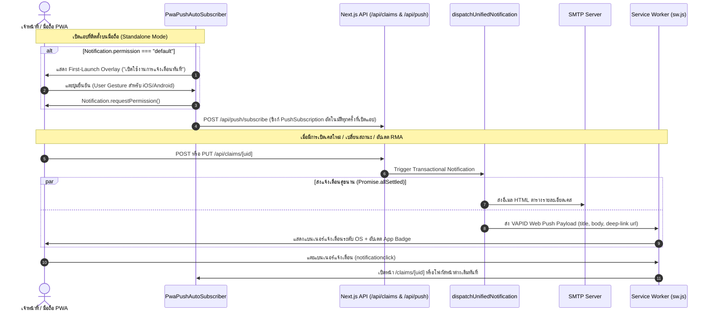

# DESIGN.md — เอกสารการออกแบบสถาปัตยกรรมและระบบ UI/UX (System & Design Specification)

**ชื่อโครงการ:** CLAIMS (CAIM) — Telecommunication Equipment Claims & Overseas RMA Management System  
**หน่วยงาน:** บริษัท ฟอร์ท คอร์ปอเรชั่น จำกัด (มหาชน) — Forth Corporation Public Company Limited  
**เวอร์ชันระบบ:** `v0.38.7` (PWA `v2.0.0`)  
**เทคโนโลยีหลัก:** Next.js 16.3.5 (App Router) · React 19 · TypeScript (Strict) · Tailwind CSS v4 · MongoDB Atlas · `@react-pdf/renderer` · Web Push (VAPID)

---

## 1. ภาพรวมและหลักการออกแบบ (Design Overview & Core Principles)

ระบบ **CLAIMS (CAIM)** ถูกออกแบบให้เป็นเว็บพอร์ทัลและแอปพลิเคชันแบบติดตั้งได้ (Progressive Web App 2.0.0) สำหรับบริหารจัดการวงจรงานเคลมอุปกรณ์โครงข่ายโทรคมนาคมและวิทยุสื่อสารเฉพาะกิจ ตั้งแต่วินาทีที่รับแจ้งเหตุขัดข้องจากสถานีสนาม การติดตามงานซ่อมศูนย์บริการในประเทศ การส่งซ่อมผู้ผลิตต่างประเทศ (Overseas RMA 8 ขั้นตอน) การควบคุมอายุใบอนุญาตส่งออก–นำเข้า กสทช./ศุลกากร ไปจนถึงการออกรายงานผู้บริหารมาตรฐาน A4

### หลักการออกแบบเชิงวิศวกรรมและประสบการณ์ผู้ใช้ (Design Pillars)
1. **Single Source of Truth & Immutable Identity:** ข้อมูลทุกส่วนดึงตรงจากฐานข้อมูลจริงโดยไม่มี Mock Fallback แยกแยะรหัสหลักที่ไม่เปลี่ยนแปลง (`uid` แบบ UUID) ออกจากเลขที่เคลมสำหรับแสดงผล (`claimNumber` รูปแบบ `CLM-YYYY-XXX`) อย่างเด็ดขาด
2. **Dual-Layer High Availability:** รองรับการทำงานต่อเนื่องแม้เครือข่ายฐานข้อมูลภายนอกขัดข้อง ด้วยสถาปัตยกรรมบันทึกข้อมูล 2 ชั้น (MongoDB Atlas คู่กับ Persistent Local JSON Store)
3. **Zero-Reload Real-Time Experience:** อัปเดตตัวเลข KPI สถานะตารางงานเคลม และแดชบอร์ดแบบเรียลไทม์ผ่าน Server-Sent Events (SSE) ร่วมกับ Client Query Cache Invalidation
4. **Enterprise Light & Dark Theme Parity:** ออกแบบระบบสีและพื้นผิว (Surface Hierarchy) ให้สอดคล้องกัน 100% ทั้งโหมดสว่าง (Light Mode) สำหรับงานเอกสาร/สำนักงาน และโหมดมืด (Dark Mode Glassmorphism) สำหรับห้องปฏิบัติการ NOC
5. **Mobile-First & Always-On Field Readiness:** รองรับการติดตั้งเป็นแอปบน iOS และ Android พร้อมระบบลงทะเบียนรับแจ้งเตือน Web Push อัตโนมัติทันทีที่เปิดแอป (Always-On Auto-Subscribe)

---

## 2. สถาปัตยกรรมระบบระดับสูง (High-Level System Architecture)

---

## 3. ระบบการออกแบบ UI/UX (UI/UX Design System & Visual Tokens)

### 3.1 ระบบตัวอักษร (Typography System)
ระบบเลือกใช้ฟอนต์ที่อ่านคมชัดทั้งภาษาไทยและรหัสทางวิศวกรรมโทรคมนาคม โดยโหลดฟอนต์ไทยแบบ Local Binary (`public/fonts/THSarabunNew*.ttf`) เพื่อป้องกันปัญหา External Font Fetch ล้มเหลวตอน Build และใช้ชุดฟอนต์เดียวกันในเอกสาร PDF:

| บทบาทการใช้งาน | ตระกูลฟอนต์ (Font Stack) | การประยุกต์ใช้งานในระบบ |
|---|---|---|
| **Primary UI Sans** | `IBM Plex Sans`, `THSarabunNew`, `Geist`, `system-ui` | หัวข้อหน้าจอ ป้ายกำกับฟอร์ม ตารางข้อมูล และข้อความทั่วไป |
| **Monospace / Tabular** | `Geist Mono`, `ui-monospace` + `tabular-nums` | เลขที่เคลม (`CLM-2026-001`), Serial Number (`S/N`), รหัสสถานี, พิกัด GPS และตัวเลข KPI |
| **Official PDF Print** | `THSarabunNew` (Regular 400 / Bold 700) | รายงานสรุป 1 หน้า A4 และรายงานประจำเดือน 4 หน้า (`@react-pdf/renderer`) |

### 3.2 ระบบสีและพื้นผิวตามธีม (Color Palette & Theme Surface Hierarchy)
กำหนดผ่าน CSS Custom Properties ใน `src/app/globals.css` ร่วมกับ `@custom-variant dark`:

| Token / พื้นผิว | Light Mode (`:root`) | Dark Mode (`.dark`) | การใช้งานมาตรฐาน |
|---|---|---|---|
| **Page Background** | `#f1f5f9` (`slate-100`) | `#0b0f19` + Ambient Radial Mesh | พื้นหลังหลักของพอร์ทัลช่วยขับให้การ์ดดูลอยเด่น |
| **Card Surface** | `#ffffff` (`bg-white`) | `#0f172a` / `#1e293b` (`dark:bg-slate-900`) | กรอบการ์ดเนื้อหา ฟอร์มแจ้งเคลม และหน้าต่าง Modal |
| **Form Input Surface** | `#ffffff` + ขอบ `border-slate-200` | `#1e293b` (`dark:bg-slate-800`) + ขอบ `dark:border-slate-700` | ช่องกรอก `<input>`, `<select>`, `<textarea>` ทุกส่วนในฟอร์ม |
| **Primary Brand** | `#1e61f0` (`--brand`) | `#38bdf8` / `#3b82f6` | ปุ่มแอ็กชันหลัก ลิงก์นำทาง แถบสถานะ Active |
| **Brand Navy** | `#0f172a` (`--brand-navy`) | `#0f172a` | ไอคอนหัวข้อหลัก และปุ่มคำสั่งระดับองค์กร |

### 3.3 สีสถานะวงจรงานเคลมมาตรฐาน (Semantic Status Pill Palette)
ใช้โทนสีเดียวกันทั้งบน Dashboard Summary Cards, ตารางงานเคลม, Stepper หน้ารายละเอียด และรายงาน PDF:

| รหัส (`statusCode`) | ชื่อสถานะ | โทนสี (Semantic Color) | ความหมายทางปฏิบัติการ |
|---|---|---|---|
| `1` | **รับแจ้ง** (`รับแจ้ง/รอตรวจสภาพ`) | Emerald / Blue Dot Pulse | เปิดเคสใหม่ รอวิศวกรตรวจสอบสภาพเบื้องต้น |
| `2` | **ส่งศูนย์** (`ส่งศูนย์บริการแล้ว`) | Purple / Indigo | ส่งมอบอุปกรณ์เข้าศูนย์ซ่อมผู้ผลิตหรือส่งต่อ RMA |
| `3` | **รออะไหล่** (`รออะไหล่/กำลังซ่อม`) | Amber / Orange | อยู่ระหว่างดำเนินการซ่อมหรือรอพาร์ททดแทน |
| `4` | **ซ่อมเสร็จ** (`ซ่อมเสร็จ/รอส่งมอบ`) | Sky / Blue | ซ่อมและทดสอบผ่านแล้ว รอส่งคืนเข้าคลัง/สถานี |
| `5` | **ปิดเคส** (`รับคืนเรียบร้อย`) | Slate / Emerald (Completed) | รับคืนอุปกรณ์และปิดงานสมบูรณ์ (หยุดนับอายุ SLA) |
| `6` | **ปฏิเสธเคลม** (`ไม่อยู่ในเงื่อนไข`) | Rose / Red | ศูนย์บริการปฏิเสธเคลม (หยุดนับอายุ SLA และแจ้งคลัง) |

### 3.4 มาตรฐานเลย์เอาต์และการตอบสนอง (Responsive & Interaction Standards)
- **AppShell Navigation:** แถบเมนูด้านซ้ายแบบย่อ/ขยายได้บน Desktop และเปลี่ยนเป็น Slide-over Drawer พร้อม Backdrop Blur บนหน้าจอมือถือ
- **Data Table Ergonomics:** ตารางรายการงานเคลมตรึงคอลัมน์ซ้ายสุด (Checkbox) และคอลัมน์ขวาสุด (ปุ่มจัดการ ดู/แก้ไข/ลบ) แบบ Sticky Column พร้อมแถบเลื่อนแนวนอนขนาดบาง (`scrollbar-subtle`)
- **Accessibility & Motion:** ตรวจสอบ `prefers-reduced-motion` บนหน้า Landing Video Portal รองรับการกดปุ่ม `Esc` และคลิก Backdrop เพื่อปิดหน้าต่าง Modal ทุกจุด และกำหนดขนาดปุ่มสัมผัสขั้นต่ำบนมือถือ (`min-h-[44px]`)

---

## 4. การออกแบบฐานข้อมูลและโมเดลข้อมูล (Data Model & Persistence Design)

### 4.1 แผนภาพความสัมพันธ์ของข้อมูล (Entity-Relationship Diagram)

### 4.2 การแยก Primary Key (`uid`) ออกจากเลขที่เคลมเรียงลำดับ (`claimNumber`)
- **ปัญหาที่ป้องกัน:** ระบบมีฟีเจอร์จัดเรียงเลขที่เคลมใหม่อัตโนมัติ (`CLM-2026-001` ถึง `CLM-2026-00N` แบบไร้ช่องว่าง) เมื่อมีการเพิ่มหรือลบเคส หากใช้ `claimNumber` เป็น Foreign Key หรือ URL Parameter จะทำให้เคสที่ถูกเลื่อนลำดับแสดงข้อมูลผิดแถวหรือดึงประวัติ Timeline ของเคสเก่าที่ถูกลบไปแล้วมาแสดงซ้อนทับ
- **สถาปัตยกรรมการแก้ไข:**
  1. ทุกเคสได้รับ `uid` (UUID) ทันทีที่สร้าง และ**ไม่เคยเปลี่ยนแปลง**ตลอดอายุข้อมูล
  2. การนำทางไปหน้ารายละเอียดเต็ม (`/claims/[uid]` และ `/tickets/[uid]`) และการผูกประวัติ `transaction_logs` (`claimId` / `claimUid`) อ้างอิงผ่าน `uid` เท่านั้น
  3. เมื่อลบเคส (`DELETE /api/claims/[id]`) ระบบรัน **Transactional Cascade Delete** ลบประวัติ `transaction_logs` ของ `uid` นั้นออกทั้งหมดใน Transaction เดียวกัน ก่อนจัดเรียง `claimNumber` ของเคสที่เหลือใหม่แบบ Two-Phase Safe Update

---

## 5. การออกแบบวงจรการทำงานและตรรกะธุรกิจ (Core Workflows & Business Logic)

### 5.1 วงจรสถานะงานเคลม 6 ขั้นตอน (Claims Lifecycle State Machine)

### 5.2 อัลกอริทึมคำนวณอายุงานและ SLA (Frozen SLA & Duration Engine)
อยู่ใน `src/lib/utils/caseDuration.ts` โดยกำหนดเกณฑ์มาตรฐาน SLA เริ่มต้นที่ **60 วัน** นับจากวันที่รับแจ้ง (`reportedDate`):
- **กรณีเคสกำลังดำเนินการ (`statusCode` 1–4):**
  $$\text{Elapsed Days} = \lfloor (\text{Current Date} - \text{Reported Date}) / 86,400,000 \rfloor$$
- **กรณีเคสปิดแล้วหรือปฏิเสธเคลม (`statusCode` 5 หรือ 6):**
  $$\text{Effective End Date} = \text{returnDate} ?? \text{closedAt} ?? \text{closedDate}$$
  ระบบ**แช่แข็ง (Freeze)** อายุงานและสถานะ SLA ณ วันที่รับคืนจริงทันที เพื่อป้องกันไม่ให้เคสที่ปิดงานเสร็จทันเวลาไปแล้วถูกคำนวณเทียบกับวันปัจจุบันจนขึ้นแจ้งเตือนเกินกำหนดผิดพลาดในภายหลัง

### 5.3 วงจรส่งซ่อมต่างประเทศ 8 ขั้นตอน (8-Stage Overseas RMA & Permit Watchlist)
จัดการใน `src/lib/utils/rmaDuration.ts` และ `src/lib/utils/permitSla.ts`:
1. รับอุปกรณ์ชำรุดเข้าคลัง RMA
2. ยื่นขอใบอนุญาตส่งออก (กสทช. / ศุลกากร — ครอบคลุมสเตจ 1–5)
3. ส่งออกอุปกรณ์ไปต่างประเทศ (DHL / FedEx Tracking)
4. ศูนย์ผู้ผลิตต่างประเทศตรวจรับและวิเคราะห์อาการ
5. ดำเนินการซ่อม / เปลี่ยนบอร์ด ณ โรงงานผู้ผลิต (ติดตามเกณฑ์ Vendor Penalty)
6. ยื่นขอใบอนุญาตนำเข้ากลับประเทศ (ครอบคลุมสเตจ 5–8)
7. ดำเนินพิธีการศุลกากรขาเข้าและขนส่งกลับไทย
8. ตรวจรับ QC ขั้นสุดท้ายและส่งคืนเข้าคลังอุปกรณ์สำรอง

---

## 6. ระบบเรียลไทม์, PWA 2.0.0 และการแจ้งเตือนคู่ขนาน (Real-Time, PWA & Push Design)

### 6.1 สถาปัตยกรรม PWA 2.0.0 (`claims-pwa-v2.0.0`)
- **Web App Manifest (`src/app/manifest.ts`):** กำหนด `display: "standalone"`, `display_override: ["window-controls-overlay", "standalone"]`, ไอคอนมาตรฐาน `192x192`, `512x512`, Maskable Icons และ App Shortcuts (เปิดเคสใหม่ / แดชบอร์ด / รายการเคลม)
- **Service Worker (`public/sw.js`):**
  - **Network-First Strategy (`/api/*`):** ดึงข้อมูลสดจากฐานข้อมูลเสมอ และสลับใช้แคชเฉพาะกรณีออฟไลน์
  - **Cache-First Strategy (Static Assets & Fonts):** แคชฟอนต์ `THSarabunNew`, ไอคอน และไฟล์สถิตเพื่อการเปิดแอปที่รวดเร็วระดับ Native
  - **Offline Fallback (`/offline`):** แสดงหน้าจอแจ้งสถานะออฟไลน์พร้อมปุ่มลองเชื่อมต่อใหม่เมื่อไม่มีสัญญาณอินเทอร์เน็ต

### 6.2 ระบบแจ้งเตือน Always-On Web Push คู่ขนานกับ SMTP Email

- **การล็อกสถานะในหน้าตั้งค่าระบบ (`SystemSettingsModal.tsx`):** การ์ด `การแจ้งเตือนผ่านแอป (PWA 2.0.0 Push Notifications)` ถูกล็อกสถานะเป็น **`บังคับเปิดอัตโนมัติ (Always On)`** เพื่อป้องกันเจ้าหน้าที่เผลอปิดการแจ้งเตือนโดยไม่ตั้งใจ พร้อมปุ่ม **`ทดสอบส่ง Push (Test Notification)`** สำหรับตรวจสอบความพร้อมของอุปกรณ์ได้ตลอดเวลา

---

## 7. ระบบออกเอกสารรายงาน PDF และพรีวิวในแอป (PDF Reporting & Preview Architecture)

ขับเคลื่อนบนฝั่ง Client แบบ Dynamic Import (`@react-pdf/renderer`) เพื่อหลีกเลี่ยงปัญหา SSR Hydration บน Next.js 16:

1. **In-App PDF Preview Modal (`src/components/pdf/PdfPreviewModal.tsx`):**
   - เมื่อกดปุ่ม **`สรุป (PDF)`** หรือ **`ส่งออกรายงานประจำเดือน (Export PDF)`** บนหน้าแดชบอร์ด ระบบจะไม่บังคับดาวน์โหลดไฟล์ทันที แต่จะเปิดหน้าต่างพรีวิวขนาดเต็มตา (`90vh`)
   - สร้างไฟล์ผ่าน `pdf(<ReportComponent />).toBlob()` แปลงเป็น `URL.createObjectURL(blob)` แสดงใน `<iframe>` พร้อมปุ่ม **`ดาวน์โหลด PDF`**, **`เปิดแท็บใหม่`** (สำหรับมือถือ/PWA ที่จำกัด iframe) และเรียก `URL.revokeObjectURL` คืนหน่วยความจำทันทีเมื่อปิดหน้าต่าง
2. **แม่แบบรายงานมาตรฐาน 2 รูปแบบ:**
   - **รายงานสรุป 1 หน้า A4 (`CaimExecutiveSummaryPDF.tsx`):** รหัสเอกสาร `CLAIMS-RPT-YYYY-MM`, การ์ดสรุปสถานะหลัก 4 ช่องตรงกับหน้าแดชบอร์ด (Total / In Progress / Closed / Rejected), กราฟสัดส่วนผลการซ่อม, สัดส่วนอุปกรณ์ครบทุกรุ่นในระบบ (100% Model Share), แถบ Pipeline และตารางรายการเคสเรียงลำดับตามเลขเคลมจริง
   - **รายงานประจำเดือนฉบับเต็ม 4 หน้า (`CaimMonthlyReportPDF.tsx`):** รายละเอียดเชิงลึก รายการเคสเกินกำหนด SLA สถานะ Overseas RMA ใบอนุญาต กสทช./ศุลกากร ข้อมูลสต็อกสำรอง และช่องลงนามผู้จัดทำ/ผู้ตรวจสอบ/ผู้อนุมัติ

---

## 8. ข้อมูลจำเพาะ API และมาตรการความปลอดภัย (API Specification & Security)

### 8.1 ตารางสรุป API Endpoints หลัก

| Endpoint | Methods | หน้าที่และการทำงานหลัก |
|---|---|---|
| `/api/claims` | `GET`, `POST`, `PUT`, `PATCH`, `DELETE` | ดึงรายการเคลมทั้งหมด, ดูเลขลำดับถัดไป (`?action=next-sequence`), เปิดเคสใหม่พร้อม Validate ด้วย Zod |
| `/api/claims/[id]` | `GET`, `PUT`, `PATCH`, `DELETE` | ดึง/แก้ไข/ลบเคสเดี่ยวโดยค้นหาจาก `uid` (Primary Key) เป็นอันดับแรก พร้อม Cascade Delete ประวัติ Timeline |
| `/api/tickets` | `GET`, `POST`, `PUT`, `DELETE` | Core Ticket Engine และ Endpoint สำหรับเชื่อมต่อระบบภายนอก (`POST` ป้องกันด้วย `Bearer <CAIM_API_KEY>`) |
| `/api/rma` & `/api/rma/permit` | `GET`, `POST`, `PUT`, `DELETE` | จัดการข้อมูลส่งซ่อมต่างประเทศ 8 ขั้นตอน และใบอนุญาตส่งออก–นำเข้า |
| `/api/equipments` & `/api/stations` | `GET`, `POST`, `PUT`, `DELETE` | ทะเบียนอุปกรณ์กลาง และข้อมูลสถานีติดตั้ง 197 แห่งทั่วประเทศ |
| `/api/dashboard/stats` & `/stream` | `GET` | คำนวณตัวชี้วัด KPI สด และส่งข้อมูลสตรีมอัปเดตแดชบอร์ด |
| `/api/realtime/stream` | `GET` (SSE) | ช่องทาง Server-Sent Events กลางสำหรับการซิงก์ข้อมูลทุกโมดูลแบบเรียลไทม์ |
| `/api/push/subscribe`, `/unsubscribe`, `/test` | `GET`, `POST`, `DELETE` | จัดการลงทะเบียน VAPID Web Push, ลบ Endpoint ที่หมดอายุ (`410`/`404`) อัตโนมัติ และส่ง Push ทดสอบ |
| `/api/settings/test-email` | `POST` | ทดสอบการเชื่อมต่อและส่งอีเมลผ่านเซิร์ฟเวอร์ SMTP |

### 8.2 มาตรการความปลอดภัยและคุณภาพโค้ด (Security & Quality Guardrails)
- **Authentication & M2M Security:** แยก Endpoint ภายในพอร์ทัล (`/api/claims`) ออกจาก Endpoint เชื่อมต่อระหว่างเครื่อง (`/api/tickets` `POST` ที่บังคับตรวจ `CAIM_API_KEY` ฝั่งเซิร์ฟเวอร์โดยไม่เปิดเผยคีย์ในฝั่งเบราว์เซอร์)
- **Non-Blocking Outbound Webhooks:** การแจ้งผลปิดเคสกลับไปยังระบบคลังสินค้า (`Stock-Flow`) ทำงานผ่าน `after()` ของ `next/server` เพื่อไม่ให้ปัญหาเครือข่ายปลายทางกระทบความเร็วในการบันทึกงานของเจ้าหน้าที่
- **Protected System Configuration:** การเข้าถึงหน้าต่างตั้งค่าระบบและรหัสผ่าน SMTP ถูกป้องกันด้วยหน้าจอยืนยันรหัสผ่านผู้ดูแลระบบ (`PasscodeModal`)
- **Strict Build Verification:** บังคับตรวจสอบ `tsc --noEmit` (TypeScript Strict Mode, ห้ามใช้ `any`), `eslint` (0 warnings) และ `next build --webpack` ก่อนส่งมอบขึ้นสาขาหลักทุกครั้ง
